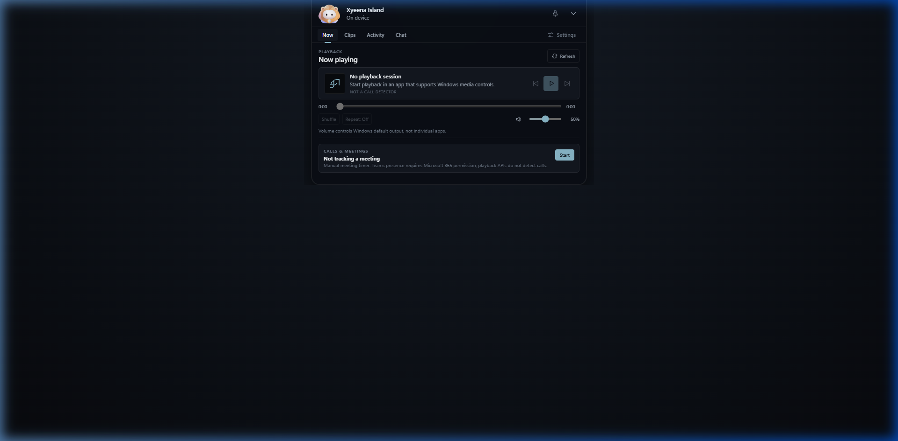
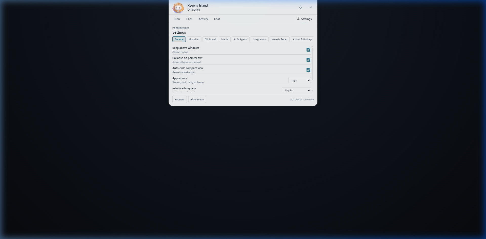
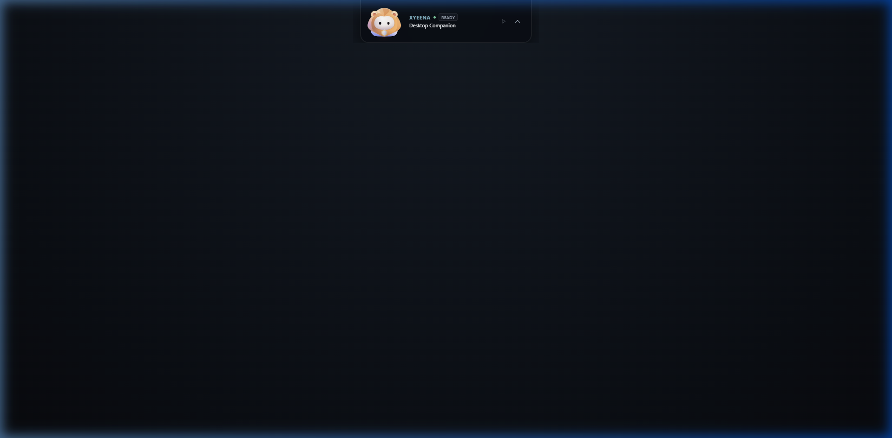

# Xyeena Notch

A privacy-first Windows desktop companion and original **Xyn Lion Guardian** mascot, built with Tauri 2, vanilla TypeScript, and Rust.

Xyeena Notch docks neatly to the top edge of your Windows display as an adaptive Island instrument panel. It combines system media session controls, default-output master volume, an in-memory unified clipboard manager, local weekly recap analytics, and an integrated multi-provider AI chat companion—all anchored by a living canvas-rendered lion guardian that responds to cursor gaze and desktop interactions.

---

## Visual Presentation

| Mode | Theme | Preview |
|---|---|---|
| **Expanded Panel** | Dark Theme |  |
| **Expanded Panel** | Light Theme |  |
| **Compact Notch** | Dark Theme |  |

---

## Key Capabilities

### 1. Adaptive Island Window Shell
- **Four Coherent Modes:**
  - **Wake Strip:** Minimalist 184×8px indicator when dormant.
  - **Compact:** 400×92px stationary top-center Notch displaying real-time playback state and mascot glance.
  - **Glance:** 480×144px asymmetric view pairing quick media controls with contextual companion status.
  - **Expanded / Pinned:** 620×396px (up to 420px) full instrument panel with dual concave shoulder wings, fluid spring animations, and tabbed single-scroll-owner panels.
- **Topmost & Tray Integration:** Stays above active windows when pinned; minimizes gracefully to the Windows system notification area.

### 2. Xyn Lion Living Guardian (`@xyeena/xyn`)
- **Integrated Mascot Framing:** Dedicated 54×54px area in a balanced 58px header, anchored directly to the Island surface with a subtle physical contact shadow—no heavy halos, double shadows, or clipping.
- **Continuous Identity & Motion:** Natural breathing, blinking, parallax eye/head gaze tracking via Windows Win32 cursor sampling, touch reactions, and autonomous emotes (salute, hop, poke).
- **Wardrobe Customization:** Concept-art accessories including Standard (Aegis Shield), Cyber Visor, Golden Crown, Studio Headset, and Silver Shield.
- **Resource & Memory Optimization:** WeakMap gradient caching, bounded canvas design space, adaptive frame-rate throttling (~30 FPS on low-motion idle, 60 FPS during active gestures), and multi-instance lifecycle synchronization that suspends inactive canvas render loops.

### 3. Media Controls & Master Audio
- **Windows GSMTC Integration:** Real-time monitoring of active Windows media sessions (Spotify, Chrome, Edge, etc.).
- **Playback & Transport:** Play/pause, next/previous track, seek bar, and shuffle/repeat toggles.
- **Master Volume Endpoint:** Debounced slider controlling the Windows default audio output endpoint, with mute toggle.

### 4. Multi-Agent Runtime & Authoritative Approvals
- **Windows Named Pipe IPC:** Secure per-user DACL Named Pipe (`\\.\pipe\xyeena-agent-<user>`) streaming real-time agent lifecycle events.
- **Contextual Agent Pills:** Multi-agent concurrent session tabs, status indicators (Active, Busy, Waiting, Done), and live tool execution telemetry.
- **Authoritative Approval Registry:** Single-use cryptographic token nonces, 3-minute TTL expiry, SHA-256 parameter fingerprint validation, and strict `Allow Once` / `Deny` / structured question responses (zero Always Allow).
- **Automated Provider Hook Installer:** Automatic discovery, atomic `.bak` backup, and idempotent install/uninstall for Antigravity, Claude Code, Codex, and Gemini CLI.

### 5. Flow Offline Dictation & Consented Notetaker
- **100% On-Device Dictation:** Offline speech processing with push-to-talk (`Alt+D`), verbal filler word filter, dictionary snippets expansion, and local statistics.
- **Consented Meeting Notetaker:** Explicit user consent gate, prominent red visual recording badges in compact and expanded views, session-memory note storage (max 20 entries), and markdown export.
- **Voice Commands for Xyn:** Hands-free control for Island modes, navigation, chat, media playback, and recap generation.

### 6. Secure Android Companion Pairing
- **Zero Cloud Relay:** Local network pairing via time-bounded 5-minute QR payload schema (`xyeena-companion-v1`), 6-digit numeric PIN, and 32-byte secret nonce.
- **Mutual Authentication:** Mobile approval decisions verified via cryptographic HMAC/FNV signatures.
- **Immediate Revocation:** Clear mobile credentials and revoke remote approval authority instantly from Settings.

### 7. External Integrations & Developer Productivity
- **Read-Only GitHub Status:** Detects active git remote and branch, displaying authentic PR draft status, reviews, and CI workflow run check rollups.
- **Connected Services Health:** Scoped health checks for Vercel, Notion, n8n, Resend, Cal.com, and Stripe with honest unconfigured reporting and zero synthetic accounts.
- **Bounded Git Diff Preview:** Safe 64KB/500-line diff viewer with path traversal validation preventing directory escape.
- **Editor & Terminal Integration:** Launch active project directly into VS Code (`code -g`) or Windows Terminal (`wt.exe` / PowerShell).

### 8. Privacy-First Unified Clipboard
- **In-Memory Retention:** Captured clips exist exclusively in application session memory; items are never written to disk, local storage, or network endpoints.
- **Win32 Sequence Number Notifications:** Zero-overhead OS clipboard polling via Win32 sequence numbers.
- **Multi-Format Support:** Captures plain text, image data URLs (BMP/PNG), and dropped file paths (50MB bound).
- **Bounded Capacity:** Strict 64 MiB total memory cap, 20 MiB per image, and configurable 20/50/100 item limits.
- **Privacy Controls:** Read-Once mode, item pinning, search filtering, sensitive credentials filter (`looksSensitive`), one-click history purge, and automatic wipe on application exit.

### 9. Multi-Provider Companion AI Chat (BYOK)
- **Supported Providers:** Google Gemini, Anthropic Claude, OpenAI, OpenRouter, and local offline models (Ollama and LM Studio).
- **Session-Only BYOK:** API keys reside in private in-memory stores; keys are never persisted to disk, localStorage, or exported in diagnostics.
- **Native Non-Blocking Transport:** Curl-based native HTTP runner in Rust with atomic cancellation registry, strict URL authority allowlists, loopback-only local routing, and 3xx redirect rejection.

### 10. Local Weekly Recap Engine (`@xyeena/recap`)
- **Zero-Cloud Analytics:** Aggregates local activity from authenticated local runs.
- **Privacy Guaranteed:** Strips sensitive strings, ignores untrusted providers, and maintains a strict rolling 12-week local archive.
- **Exportable Artifacts:** Formats clean ASCII markdown summaries and generates standalone 1080×1920 SVG cards.

### 11. Settings, Theming & Accessibility
- **Appearance:** Low-chroma Dark, crisp Light, and automatic Windows System themes conforming to WCAG AA contrast standards.
- **Focus & Keyboard Navigation:** Comprehensive `:focus-visible` outlines, arrow key navigation across navigation tabs and settings pills, and full screen-reader compliance.
- **Motion Settings:** Full support for `prefers-reduced-motion` and manual toggle to disable spring transitions and lock mascot animation to static pose.
- **High-Contrast & High-DPI:** Native Windows forced-colors mode support and sub-pixel antialiased text rendering.
- **Internationalization:** Complete 1:1 key parity between English and Bahasa Indonesia across all tabs, panels, and settings.
- **Feedback:** Optional synthesized audio feedback with volume attenuation.

---

## Privacy & Security Architecture

Xyeena Notch is engineered around verifiable security boundaries:

- **No Remote Telemetry or Tracking:** Zero analytics SDKs, tracking pixels, or outbound telemetry pings.
- **In-Memory Secrets:** BYOK API credentials exist solely in heap memory and vanish when the app closes.
- **Local Model Isolation:** Local endpoints (Ollama/LM Studio) are strictly enforced to loopback addresses (`localhost` or `127.0.0.1`) and reject cloud credentials.
- **Read-Only Project Inspection:** Run summaries only read `.xyeena/runs/*/snapshot.json` files from explicitly selected local paths; the app has no write authority over user projects.
- **Least-Privilege Tauri Manifest:** Tauri IPC permissions are strictly limited to core clipboard read/write and window frame geometry.

See [SECURITY.md](SECURITY.md) for the complete security policy and threat model.

---

## Monorepo Structure

```
xyeena-notch/
├── apps/
│   └── xyeena-island/          # Main Tauri 2 desktop application (Vite + TypeScript + Rust)
├── packages/
│   ├── xyn/                   # Canonical Xyn Lion custom element (<xyeena-guardian>)
│   └── xyeena-recap/          # Weekly recap aggregation engine and SVG generator
├── examples/
│   └── guardian-playground/   # Browser-only development harness for mascot testing
├── docs/                      # Architectural specs, feature matrices, and release guides
└── scripts/                   # Audit, verification, and packaging automation
```

---

## Windows Prerequisites & Installation

### Supported Systems
- **OS:** Windows 10 (version 1903+) or Windows 11 (64-bit).
- **Runtime:** Microsoft Edge WebView2 Evergreen Runtime (pre-installed on Windows 11 and updated Windows 10).

### Download & Install
1. Download the latest `xyeena-island_1.0.0-alpha.1_x64-setup.exe` installer from [GitHub Releases](https://github.com/rzqllh/xyeena-notch/releases).
2. Run the unsigned NSIS installer. It installs for the current user into `%LOCALAPPDATA%\Programs\xyeena-island` without requiring administrator privileges.
3. Launch **Xyeena Island** from the Windows Start Menu or system tray.

> [!NOTE]
> The prerelease installer is unsigned. Windows SmartScreen may display an informational prompt on initial launch. Check the published SHA-256 checksum against the release notes to verify package integrity.

---

## Local Development & Build

### Prerequisites
- [Node.js](https://nodejs.org/) 22.14.0 or newer
- [Rust](https://rustup.rs/) stable with `x86_64-pc-windows-msvc` toolchain
- Visual Studio 2022 Build Tools with **Desktop development with C++** workload
- Windows 10/11 SDK

### Build Commands

```powershell
# 1. Install locked dependencies across all monorepo workspaces
npm ci

# 2. Run the complete automated test suite (105 JS/TS tests + 10 Rust tests)
npm test

# 3. Compile TypeScript, bundle web assets with Vite, and build playground
npm run build

# 4. Verify toolchain prerequisites
npm run doctor

# 5. Run version, lockfile, manifest, and license audit
npm run release:audit

# 6. Run all monorepo release verification gates
npm run check

# 7. Start the local Tauri development app
npm run desktop
```

### Rust Testing & Linting

```powershell
cd apps/xyeena-island/src-tauri
cargo fmt --all -- --check
cargo clippy --locked --all-targets -- -D warnings
cargo test --locked
```

---

## Current Release Status & Limitations

- **Release Classification:** `1.0.0-alpha.1` (Experimental Windows Prerelease).
- **Unimplemented / Deferred Capabilities:**
  - Automatic Microsoft Teams call detection (Microsoft 365 Graph presence API deferred).
  - Global system hotkeys (deferred for conflict testing).
  - Direct shell script execution / automatic agent hook mutation (by design).
  - Linux and macOS builds (Windows-first alpha).

For detailed status by component, see [docs/FEATURE_STATUS.md](docs/FEATURE_STATUS.md).

---

## Upstream Attribution & License

- **License:** MIT License. See [LICENSE](LICENSE) for terms.
- **Motion Mathematics Attribution:** Spring dynamics and cubic Bézier timing curves adapted from Coucou under MIT (Copyright © 2026 Louis Raillé). See [THIRD_PARTY_NOTICES.md](THIRD_PARTY_NOTICES.md) and [licenses/COUCOU-CODE-MIT.txt](licenses/COUCOU-CODE-MIT.txt).
- **Original Assets:** Xyeena brand, Island interface design, icons, and Xyn Lion Guardian artwork are original works. No Coucou or Mochi proprietary assets, media, sounds, or trademarks are distributed.
